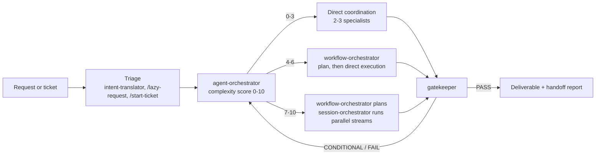

# Agent Framework for Claude Code

A multi-agent engineering framework for [Claude Code](https://docs.claude.com/en/docs/claude-code). It provides 44 subagents, an orchestration layer that scores task complexity and routes work, policies that act as quality gates, a YAML ticket workflow, and session handoff reports. Everything lives in a `.claude/` directory that you copy into a project or into `~/.claude/`.

The framework covers engineering work and also business, product, marketing, and creative work, with the same quality bar applied across domains.

## Contents

```
.claude/
├── CLAUDE.md            # Template project instructions (edit the "Project Layout" section)
├── agents.md            # Agent catalog index
├── agents/<category>/   # 44 subagent definitions
├── commands/            # 11 slash commands
├── commands.json        # Command index
├── policies/            # Engineering, orchestration, file organization, tickets, writing, ...
├── workflows/           # Coordination, development, ticket, and handoff workflows
├── workflows.md         # Workflow navigation index
├── templates/           # Work order template
├── issues/template.yaml # Ticket schema
├── scripts/validate-lint.sh
└── mcp_servers.md       # Place to list your MCP servers
```

## Architecture

Requests enter through triage, move to the orchestrator for scoring and routing, are executed by specialist agents, and pass a quality gate before delivery.



### Triage
Rough requests go to `intent-translator` (directly, or through `/lazy-request`), which restates them as role, objective, approach, and output. Tickets enter through `/create-ticket`, `/assign-ticket`, and `/start-ticket`.

### Complexity score (0-10)
`agent-orchestrator` scores each request on three dimensions:

| Dimension | Points |
|-----------|--------|
| Agents required (2-3 = 1, 4 = 1.5, 4-6 complex = 2, 7-10 = 3, 10+ = 4) | 0-4 |
| Domain complexity (single = 0 up to 5+ domains = 3) | 0-3 |
| Coordination (sequential = 0, basic parallel = 1, complex dependencies = 2, multi-session state = 3) | 0-3 |

Routing by score:

- **0-3**: `workflows/direct-coordination-workflow.md`
- **4-6**: `workflows/complex-planning-direct-execution-workflow.md` (fast-track to direct coordination for familiar patterns)
- **7-10**: `workflows/complex-planning-delegated-execution-workflow.md`, with `session-orchestrator` running parallel streams and checkpoints

The orchestrator also defines context budgets for handoffs, timeouts per phase, and recovery paths for planning, execution, and integration failures.

### Specialists with per-agent model and temperature
Each agent file sets a `model` (`sonnet`, or `opusplan` for planning-heavy roles such as `technical-architect`, `business-strategist`, and `agent-optimizer`). Most also carry a `temperature` value chosen by role: low (0.1) for validators such as `gatekeeper`, `qa-engineer`, and `financial-analyst`; higher (0.6-0.8) for generative roles such as `agent-systems-architect` and `guerilla-marketing-strategist`. Claude Code does not apply `temperature` from subagent frontmatter; the framework uses it as documented intent, and `agent-optimizer` reads and maintains it.

### Policies as quality gates
Files in `.claude/policies/` define what "done" means, and agents reference them directly:

- `engineering.md`: type checks, zero-warning lint, no `any`, tests before implementation
- `orchestration.md`: dispatch rules, pre-flight checks, deliverable manifests, and verification that files were written
- `file-organization.md`: where every deliverable goes (`/deliverables/...`), never the project root or `.claude/issues/`
- `ticket-system.md`: ticket fields, naming, and lifecycle
- `writing.md`: voice and style for written output
- `business-strategy.md`, `expo-react-native.md`, `mcp_server_guidelines.md`: domain-specific rules

`gatekeeper` checks completeness, accuracy, sources, consistency, professional quality, and actionability, and returns PASS, CONDITIONAL, or FAIL. Orchestrated work does not reach the user without a gatekeeper result.

### Ticket workflow
Tickets are YAML files in `.claude/issues/` named `YYYY-MM-DD-HHMMSS-<slug>.yaml`, following `issues/template.yaml`. Each has severity (Blocker/Major/Minor), effort (XS-XL), status (Open, In Progress, Blocked, Resolved, Closed), acceptance criteria, and debugging fields for bugs. `/assign-ticket` maps the ticket's domain and effort to an agent; `/start-ticket` routes it through the orchestrator. Resolved tickets move to `.claude/issues/resolved/YYYY-MM/`.

### Handoff reports
`/handoff-report` follows `workflows/handoff-report-workflow.md` to produce one standardized report per session: work completed, files changed, verification results, blockers by priority, and next steps, so a later session can resume without re-discovery.

## Agent catalog

| Agent | Category | Purpose | Model | Temp |
|---|---|---|---|---|
| agent-orchestrator | agent-management | Entry point for multi-domain work; complexity scoring and workflow routing | sonnet | 0.25 |
| gatekeeper | agent-management | Quality validation gate for deliverables | sonnet | 0.1 |
| session-orchestrator | agent-management | Multi-session workflow state, checkpoints, and parallel execution | sonnet | 0.25 |
| workflow-orchestrator | agent-management | Multi-agent execution planning | sonnet | 0.25 |
| agent-systems-architect | engineering | Multi-agent workflow design and governance | opusplan | 0.6 |
| android-expo-architect | engineering | Android-specific Expo development and optimization | sonnet | 0.15 |
| cloud-infrastructure-architect | engineering | Cloud infrastructure design, Terraform, AWS/GCP architecture | sonnet | 0.25 |
| devops-engineer | engineering | CI/CD, infrastructure, deployment automation | sonnet | 0.2 |
| expo-react-native-specialist | engineering | Cross-platform mobile development | sonnet | 0.2 |
| integration-engineer | engineering | System integrations and API connectivity | sonnet | 0.2 |
| ios-expo-architect | engineering | iOS-specific Expo development and optimization | sonnet | 0.15 |
| qa-engineer | engineering | Test strategy, automation, quality assurance | sonnet | 0.1 |
| react-vite-engineer | engineering | React/Vite applications, TypeScript, Tailwind CSS, front-end build optimization | sonnet | - |
| security-architect | engineering | Threat modeling, compliance, security design | sonnet | 0.2 |
| tech-stack-analyst | engineering | Technology evaluation and architecture audit | sonnet | 0.2 |
| technical-architect | engineering | System design, API and data architecture, roadmaps | opusplan | 0.25 |
| template-systems-developer | engineering | Template engines and systems | sonnet | 0.15 |
| business-requirements-analyst | business | Strategic requirements and operational planning | sonnet | 0.3 |
| business-strategist | business | Business models and go-to-market strategies | opusplan | 0.4 |
| compliance-agent | business | Regulatory compliance and legal documents | sonnet | - |
| financial-analyst | business | Financial modeling and viability assessment | sonnet | 0.1 |
| legal-reviewer | business | Legal risk assessment and compliance review | sonnet | 0.1 |
| project-manager | business | Timeline coordination and deliverable packaging | sonnet | 0.25 |
| technical-writer | business | API docs, guides, README creation | sonnet | 0.25 |
| vc-advisor | business | Investment analysis from an investor perspective | opusplan | 0.2 |
| requirements-to-stories | product | Requirements converted to user stories | sonnet | 0.25 |
| spec-decomposer | product | PRDs decomposed into development phases | sonnet | 0.3 |
| spec-writer | product | Roadmap phases expanded to developer specs | sonnet | 0.3 |
| brand-hierarchy-strategist | marketing | Brand architecture and portfolio strategy | opusplan | - |
| brand-research-analyst | marketing | Brand auditing and competitive analysis | sonnet | - |
| branding-specialist | marketing | App branding and visual identity | sonnet | - |
| content-strategy-agent | marketing | Messaging frameworks and voice guidelines | sonnet | - |
| guerilla-marketing-strategist | marketing | Low-cost, unconventional growth tactics | sonnet | 0.8 |
| marketing-expert | marketing | App store optimization and user acquisition | sonnet | 0.5 |
| mobile-app-marketing-expert | marketing | Mobile marketing and growth strategies | sonnet | 0.3 |
| brand-designer | creative | Visual identity systems and brand assets | sonnet | 0.4 |
| creative-project-brainstormer | creative | Feature ideation and creative riffing | opusplan | - |
| design-qa-reviewer | creative | Design quality scoring and assessment | sonnet | - |
| graphic-design-artist | creative | Logos, graphics, marketing visuals | sonnet | 0.9 |
| senior-frontend-layout-expert | creative | Advanced CSS and layout algorithms | sonnet | - |
| typography-specialist | creative | Font selection and text hierarchy | sonnet | 0.25 |
| agent-optimizer | utility | Agent config tuning and optimization | opusplan | 0.2 |
| ai-prompt-optimizer | utility | Prompt engineering and LLM optimization | opusplan | - |
| intent-translator | utility | Requirement clarification into actionable tickets | sonnet | - |

`opusplan` is a Claude Code model alias (Opus for planning, Sonnet for execution). If your Claude Code version does not accept it in subagent frontmatter, change it to `opus` or `sonnet`.

## Slash commands

| Command | Purpose |
|---------|---------|
| `/create-ticket` | Create a YAML ticket in `.claude/issues/` |
| `/assign-ticket` | Assign a ticket to an agent by domain and effort |
| `/start-ticket` | Route a ticket through the orchestrator |
| `/handoff-report` | Write a session handoff report |
| `/lazy-request` | Turn a rough request into a structured brief, then execute it |
| `/optimize-agent` | Tune an agent's model, temperature, and prompt with `agent-optimizer` |
| `/update-engineering-agents` | Apply policy references across engineering agents |
| `/design-loop` | Produce a design, score it with `design-qa-reviewer`, revise once if below threshold |
| `/create-campaign` | Draft a zero-budget guerrilla marketing campaign |
| `/venture-pack` | Run the business pipeline: market scan, strategy, requirements, financials, investor critique |
| `/migrate-files` | Move misplaced deliverables into the `/deliverables/` structure |

## Install

Requires a POSIX shell and Claude Code.

```bash
git clone <this-repo> agent-framework
cd agent-framework

# Into a project (creates <project>/.claude/ if missing)
./install.sh ~/code/my-project --dry-run   # preview
./install.sh ~/code/my-project

# Or globally, for every project
./install.sh --global
```

`install.sh` copies files that do not exist yet and prints `skip` for each file already present. It never overwrites or deletes anything. To take an updated version of a file you already have, compare and merge it by hand.

You can also copy the directory yourself: `cp -Rn .claude ~/code/my-project/`.

## Usage

- Ask Claude Code for multi-domain work and name the entry point: "Use agent-orchestrator to plan and build the onboarding flow."
- Call a specialist by name for single-domain work: "Have security-architect threat-model the payment webhook."
- Use the slash commands above for tickets, handoffs, and packaged workflows.
- Run `.claude/scripts/validate-lint.sh` from a project root to apply the lint, type, and forbidden-pattern checks from `engineering.md` (expects `yarn lint` and `yarn tsc`).

## Customizing

- **Project layout**: edit the "Project Layout" section of `.claude/CLAUDE.md`. Paths such as `/apps/mobile` and `/supabase` are examples.
- **Toolchain**: `engineering.md`, the engineering agents, and `validate-lint.sh` assume Yarn, TypeScript, and ESLint. Replace the commands if you use npm, pnpm, or another stack.
- **Drop what you do not use**: delete `policies/expo-react-native.md` and the Expo agents if you do not build mobile apps, and remove their entries from `agents.md`.
- **Add agents**: put a Markdown file with `name`, `description`, and `model` frontmatter in `.claude/agents/<category>/`, add it to `agents.md`, and run `/optimize-agent <name>`.
- **Community agents**: install any of the agents listed below, then add them to the routing lists in `commands/assign-ticket.md` and `workflows/ticket-management.md`. The routing already names them as optional and falls back to included agents when they are absent.
- **MCP servers**: list them in `.claude/mcp_servers.md`. Some business agents name optional tools (for example `web.search`, `unitecon.calc`) that come from a business-strategy MCP server; without one, they fall back to built-in search and inline calculation.

## Community agents this framework works with

These agents are referenced as optional by the routing tables but are not included here, because they are adapted from public collections. Get them from their sources:

| Agent | Source |
|-------|--------|
| ai-engineer, backend-architect, data-scientist, performance-engineer | [wshobson/agents](https://github.com/wshobson/agents) |
| typescript-pro, nextjs-pro, ui-designer, ux-designer, product-manager, documentation-expert | [lst97/claude-code-sub-agents](https://github.com/lst97/claude-code-sub-agents) |
| content-marketer, context-manager, market-research-analyst | [davepoon/claude-code-subagents-collection](https://github.com/davepoon/claude-code-subagents-collection) |
| code-reviewer, react-component-architect | [vijaythecoder/awesome-claude-agents](https://github.com/vijaythecoder/awesome-claude-agents) |

Several of these names exist in more than one collection; any compatible version works. See the "Optional Community Agents" table in `.claude/agents.md` for the role each fills and the included fallback.

## Attribution

Written by Tony DiCenzo. The orchestration layer, policies, workflows, commands, ticket system, and the 44 agents in this repository are original to this framework. Thanks to the authors of the community collections above, whose work shaped the agent format used across the Claude Code community.

## License

MIT. See [LICENSE](LICENSE).
